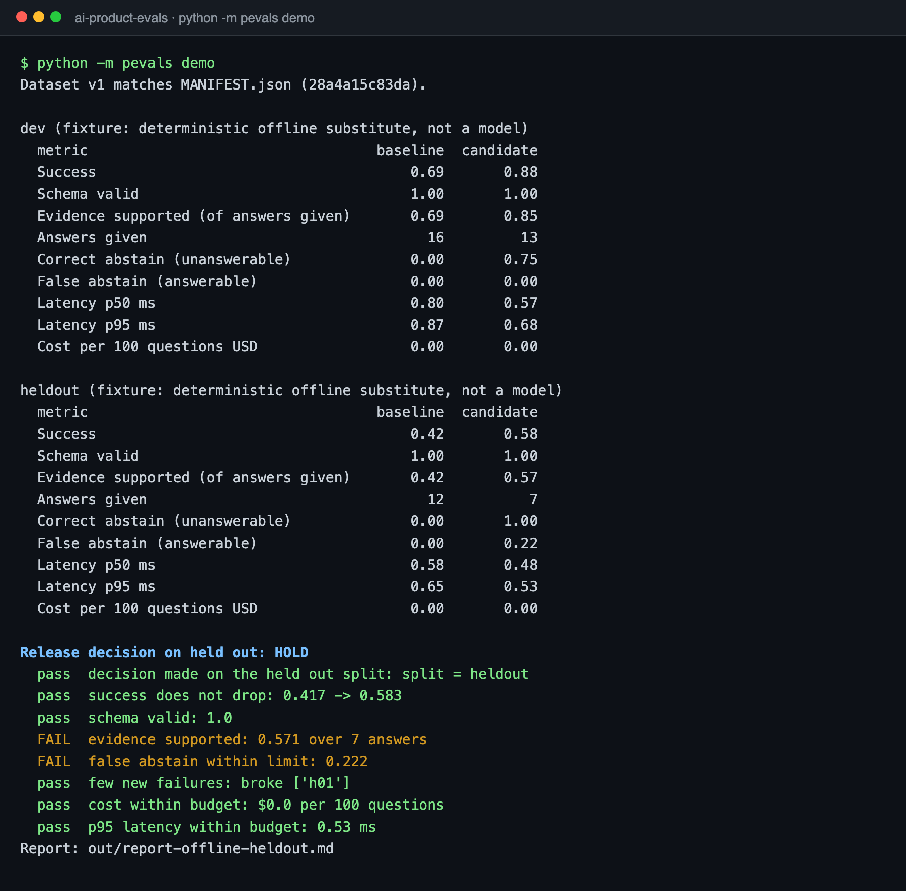

# ai-product-evals

Should the new prompt ship? This repo answers that with numbers instead of a demo: run a baseline and a candidate on the same versioned questions, grade them with deterministic checks, and apply a written release rule on a held out split.

> **What it found:** a candidate prompt that looked like a clean win on dev (more correct refusals, nothing broken) was held on the held out set. It refused 2 of 9 questions it should have answered, and 3 of its 7 answers quoted a sentence that does not contain the answer. The headline success rate still went up. [Details](#results).

**Status:** runnable · 23 unit tests · CI makes no model calls · results below are fixture runs, labelled as such · last verified 2026-10-15

## Why this exists

Most AI features ship on a handful of good looking examples. The failure shows up later, as an answer that sounds right but cites nothing, or a "safer" prompt that quietly refuses questions it used to answer. A product manager needs a small harness that makes those trade offs visible before launch and a rule that says ship or hold.

**Who it is for:** PMs and engineers deciding whether a prompt or model change is ready.

**My part:** I designed the task, the metrics, the split discipline and the release rule, and wrote the code with Claude Code. The harness shape (baseline versus candidate on a fixed set, cost from token usage, a regression gate against saved results) comes from the scripts I used to test the `/pm` router in [prodman-stack](https://github.com/aragjha/prodman-stack). This is a fresh rewrite; no code is shared.

## The task

Answer customer questions about a fictional notes app, Lumen Notes, from 8 short help center pages. Every answer is JSON:

```json
{"answer": "Deleted notes stay in Trash for 30 days.", "abstain": false,
 "citations": [{"doc_id": "trash", "quote": "Deleted notes stay in Trash for 30 days."}]}
```

Some questions are not covered by the help center. The right behaviour there is `"abstain": true`.

| Split | Questions | Answerable | Not covered | Used for |
|---|---|---|---|---|
| dev | 16 | 12 | 4 | building and tuning |
| heldout | 12 | 9 | 3 | the release decision only |

Data lives in [data/v1/](data/v1/). [MANIFEST.json](data/v1/MANIFEST.json) holds a sha256 per file; `python -m pevals check-data` fails if v1 was edited. Changing the data means a v2, never a silent edit.

## Run it in 30 seconds

Python 3.10 or newer. No packages, no key, no network. On macOS, type `python3` wherever this page says `python`.

```bash
git clone https://github.com/aragjha/ai-product-evals && cd ai-product-evals
python -m pevals demo
```



## Metrics

All graded by code in [pevals/graders.py](pevals/graders.py). No model grades anything in the decision.

| Metric | Definition |
|---|---|
| Success | answerable: did not abstain and the answer contains every expected fact. Not covered: abstained |
| Schema valid | output parses as JSON with exactly `answer`, `abstain`, `citations` and the right types |
| Evidence supported | of answers given: every quote is copied word for word from the doc it cites, and the quotes contain every expected fact |
| Correct abstain | share of not covered questions where the system abstained |
| False abstain | share of answerable questions where the system abstained |
| Latency | p50 and p95 per question, milliseconds |
| Cost | from token usage and list prices in [pevals/pricing.py](pevals/pricing.py), per 100 questions |

An optional model judge scores answer clarity from 1 to 5. It is live only, saved to a separate file, printed in its own report section, and never part of the release rule.

## Release rule

From [config/release_rule.json](config/release_rule.json). The candidate ships only if every check passes on the held out split:

| Check | Bar |
|---|---|
| Decided on held out | the rule refuses a decision made on dev |
| Success | no lower than baseline |
| Schema valid | 100% |
| Evidence supported | at least 90% of answers given |
| False abstain | at most 15% |
| New failures | at most 1 question the baseline got right |
| Cost | at most $2.00 per 100 questions |
| p95 latency | at most 10 seconds |

## Results

**Label: fixture.** These runs use two deterministic offline substitutes, not language models, so the harness runs anywhere for free. The baseline answers every question with the best matching help center sentence. The candidate uses the same retrieval but abstains when the match is weak. Saved in [results/](results/); CI reruns them and fails on any change.

| Metric | dev baseline | dev candidate | held out baseline | held out candidate |
|---|---|---|---|---|
| Success | 0.69 | 0.88 | 0.42 | 0.58 |
| Schema valid | 1.00 | 1.00 | 1.00 | 1.00 |
| Evidence supported | 0.69 | 0.85 | 0.42 | 0.57 |
| Correct abstain | 0.00 | 0.75 | 0.00 | 1.00 |
| False abstain | 0.00 | 0.00 | 0.00 | 0.22 |
| Cost per 100 questions | $0 | $0 | $0 | $0 |

**Decision: HOLD.** Full report: [results/report-offline-heldout.md](results/report-offline-heldout.md).

What happened, and why the split matters:

1. On dev the candidate looked like a clean win. It correctly abstained on 3 of the 4 questions the help center does not cover, broke nothing, and never abstained wrongly. Its one setting (minimum word overlap of 2) was chosen on dev, before held out was run ([how](docs/method.md)).
2. On held out, the first time it was run, the candidate refused 2 of 9 answerable questions ("Are monthly subscriptions refundable?" and "Where does a restored note go?"). Users phrase things differently from the docs, and a word overlap threshold cannot see that.
3. Evidence support was 0.57: 3 of its 7 answers quoted a sentence that does not contain the answer, 2 of them from the right page.

So the rule holds the release on two checks, false abstain and evidence support, even though success went up. That is the trade off this repo exists to show: a "safer" candidate that abstains more can look better on the headline number and still be worse for users.

The runs folder logs every candidate run on held out. It shows 1. More than one would mean the held out set was used for tuning.

**Live Claude run: not run yet.** [prompts/baseline.md](prompts/baseline.md) and [prompts/candidate.md](prompts/candidate.md) are written, and the Claude system is tested against a fake client. A live run needs an API key and an explicit `--yes`; results will be labelled "measured: live model run" with model, tokens, latency and cost.

## Live runs

```bash
pip install anthropic
cp .env.example .env    # add ANTHROPIC_API_KEY, then export it in your shell
python -m pevals demo --system claude --max-cost-usd 1.00            # prints an estimate and stops
python -m pevals demo --system claude --max-cost-usd 1.00 --yes      # runs, stops hard if a variant passes $1.00
python -m pevals judge --system claude --variant candidate --split heldout --yes   # optional clarity judge
```

Default model is `claude-opus-5-5`; set `PEVALS_MODEL` or `--model` to compare models instead of prompts.

## Layout

```
data/v1/            corpus, dev.jsonl, heldout.jsonl, MANIFEST.json
prompts/            baseline and candidate system prompts for the live system
config/             release_rule.json
pevals/graders.py   deterministic checks
pevals/report.py    metrics, paired comparison, release decision
pevals/judge.py     optional live judge, reported separately
pevals/systems/     offline substitutes and the Claude system
results/            saved fixture runs and reports
```

## Design decisions

- **Deterministic first.** Every number in the decision comes from code, so it reproduces exactly and costs nothing in CI.
- **Judge kept apart.** A model judge is useful for style, but mixing it into the gate makes a release depend on another model's mood.
- **Paired comparison.** The report lists which questions the candidate fixed and which it broke, because an average can hide a regression on the one question that matters.
- **Held out is spent once.** The log makes reuse visible instead of relying on discipline.
- **Budgets before calls.** Live runs print an estimate, need `--yes`, and stop at a hard dollar cap.

## Limits

- 28 questions is enough to show the method, not to estimate a rate with confidence. A difference of one question moves held out success by 0.08.
- Success checks that expected facts appear in the answer, so a correct answer that rephrases a number ("two weeks" for "14 days") is marked wrong.
- The offline substitutes are retrievers, not models. Their failures are real but simpler than a model's.
- Prices in `pricing.py` are list prices as of 2026-10 and must be updated by hand.

## Roadmap

- Live Claude results for both prompts, and a model comparison on the same prompt.
- 100 or more questions with bootstrapped confidence intervals.
- A structured extraction task alongside the grounded answer task.
- Prompt caching for the corpus, with cost before and after.

## Related

- [claude-pm-os](https://github.com/aragjha/claude-pm-os): meeting notes to brief, tickets and QA with human gates and evals.
- [clinical-extraction-lab](https://github.com/aragjha/clinical-extraction-lab): evidence span extraction with a reviewer workflow on synthetic records.

## Scope and privacy

Lumen Notes, its help center and every question are invented for this repo. No employer code, customer data or internal documents are included.

## License

MIT. See [LICENSE](LICENSE).
